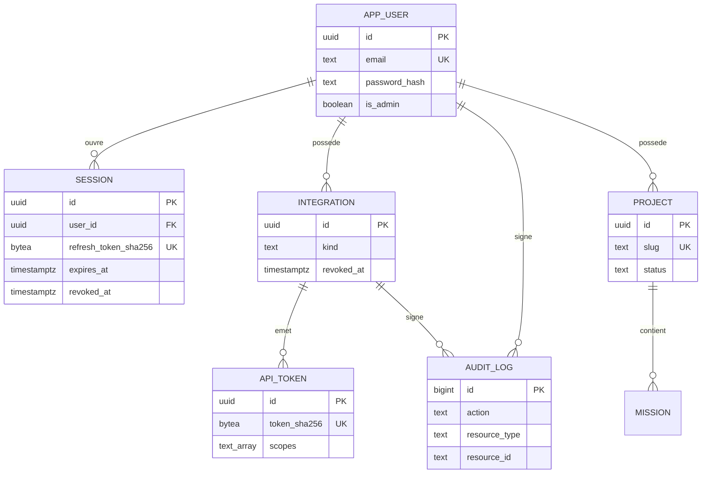
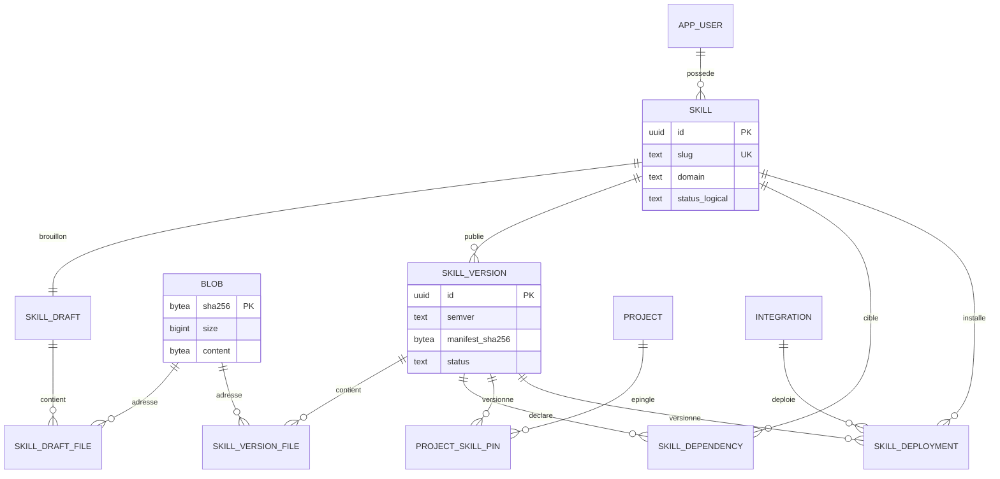
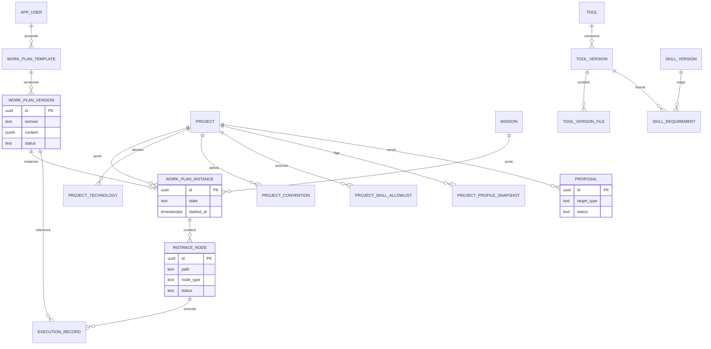

# Schéma de données v0

| Champ | Valeur |
|---|---|
| Tâche | `E0-06` — Modèle de données v0 (diagramme + DDL des tables MVP) |
| Statut | Spécification validée, DDL exécutable |
| Portée | Entités critiques du plan §4 (Skills, plans, identité/intégrations/audit, outils/propositions) |
| Fichiers | [`schema-v0.sql`](schema-v0.sql) (DDL), [`schema-v0.verify.sql`](schema-v0.verify.sql) (invariants) |
| Suite | Traduction en migration Alembic en **E0-09**, puis complétion des entités métier en E3/E5/E9/E10 |

## Principes

- **PostgreSQL 16**, schéma `public`, noms en `snake_case`.
- **Identifiants** : `uuid` générés par `gen_random_uuid()` (sauf `audit_log.id` en `bigint identity`,
  car le journal est à fort volume et n'est jamais exposé comme ressource métier).
- **Horodatages** : `timestamptz` en UTC, `now()` par défaut.
- **Statuts** : `text` + contrainte `CHECK` plutôt qu'un type `ENUM`. Les états provisoires
  évolueront (E1/E2/E9) ; modifier un `CHECK` est une migration simple, `ALTER TYPE` ne l'est pas.
- **Empreintes** : `bytea` de 32 octets (SHA-256 binaire), jamais du texte hexadécimal.
- **Immuabilité** : garantie par triggers PostgreSQL, pas seulement par le code applicatif.
- **`user` est réservé** en SQL : la table s'appelle `app_user`.
- **`constraint` est réservé** : la colonne du plan devient `version_constraint`.

## Diagrammes

### Identité, projets, audit



### Skills, blobs et versions



### Plans, exécution, outils et propositions



## Inventaire des tables (30)

| Domaine | Table | Rôle | Points clés |
|---|---|---|---|
| Identité | `app_user` | utilisateurs | e-mail unique insensible à la casse (index `lower(email)`), indicateur `is_admin` |
| Identité | `session` | refresh tokens | hash SHA-256 unique, expiration, révocation, rotation |
| Identité | `integration` | environnements/agents connectés | propriétaire, révocation |
| Identité | `api_token` | jetons d'intégration | hash SHA-256 unique, scopes non vides |
| Projets | `project` | squelette projet | slug unique ; champs métier complétés en E3-01 |
| Projets | `mission` | squelette mission | rattachée à un projet ; complétée en E3-03 |
| Skills | `skill` | identité logique d'une Skill | slug unique, domaine, statut logique, tags (E2-13) |
| Skills | `blob` | contenus adressés par hash | immuable, hash et taille vérifiés par `CHECK` |
| Skills | `skill_version` | version publiée | `UNIQUE(skill_id, semver)`, immuable hors cycle de vie |
| Skills | `skill_draft` | brouillon courant | un seul par Skill (unicité), verrou optimiste `lock_version` |
| Skills | `skill_draft_file` | arborescence du brouillon | FK vers `blob`, chemins sûrs |
| Skills | `skill_version_file` | arborescence d'une version | immuable |
| Skills | `skill_dependency` | dépendances entre Skills | contrainte de version, auto-dépendance interdite (trigger) |
| Skills | `skill_deployment` | déploiement par intégration | FK composite `(version_id, skill_id)` |
| Skills | `project_skill_pin` | épinglage projet → version | FK composite : la version appartient bien à la Skill |
| Plans | `work_plan_template` | modèle de plan A/B/C/D | slug unique par catégorie |
| Plans | `work_plan_version` | version de plan | modifiable en brouillon, immuable une fois publiée |
| Plans | `work_plan_instance` | instance pour projet **ou** mission | exactement une cible (`num_nonnulls = 1`) |
| Plans | `instance_node` | nœud phase/activité/tâche/sous-tâche | chemin unique par instance, overrides locaux |
| Audit | `audit_log` | journal append-only | `UPDATE`/`DELETE`/`TRUNCATE` rejetés par trigger |
| Exécution | `execution_record` | trace d'exécution | tâche, version de plan, Skills utilisées, résultat |
| Outils | `tool` | catalogue de scripts | slug unique, origine `import`/`created` |
| Outils | `tool_version` | version de script | immuable hors cycle de vie |
| Outils | `tool_version_file` | fichiers d'un script | immuable |
| Outils | `skill_requirement` | exigences déclarées par une version de Skill | index dérivé du manifeste ; forme contrainte par `kind` |
| Projets | `project_technology` | technologies déclarées | statut de décision, décision horodatée |
| Projets | `project_skill_allowlist` | Skills autorisées | clé composite |
| Projets | `project_convention` | conventions vérifiables | clé `(project_id, key)` |
| Propositions | `proposal` | propositions génériques | machine à états, auto-décision d'intégration interdite |
| Projets | `project_profile_snapshot` | profil technique figé | empreinte calculée et immuable |

## Invariants du plan §4 → mécanismes SQL

| Invariant | Mécanisme implémenté |
|---|---|
| Version `published`/`deprecated`/`archived` non modifiable, transitions `published → deprecated → archived` uniquement | `workhub_version_guard()` sur `skill_version` et `tool_version` ; `workhub_work_plan_version_guard()` sur `work_plan_version` (brouillon encore éditable) |
| Fichiers d'une version non modifiables | `workhub_reject_mutation()` sur `skill_version_file` et `tool_version_file` |
| Blob jamais modifié, suppression réservée au GC explicite | `workhub_blob_guard()` + GUC `workhub.allow_blob_gc` ; `CHECK` hash/taille |
| `UNIQUE(skill_id, semver)` | `ux_skill_version_semver` |
| SemVer strictement supérieur / patch de branche | Validé applicativement (ADR 003) + test property-based en E2-06 ; SQL valide seulement le format |
| `manifest_sha256` = hash du manifeste | Calcul applicatif à la publication ; taille contrôlée en SQL ; recalcul vérifié à l'export (E2-09) |
| Épinglage : la version appartient à la Skill | FK composite `(version_id, skill_id) → skill_version(id, skill_id)` |
| Version de modèle d'instance figée | `workhub_instance_guard()` : `template_version_id` immuable |
| `audit_log` append-only | `workhub_reject_mutation()` sur `UPDATE`/`DELETE` |
| `tool_version` publiée immuable | `workhub_version_guard()` |
| `skill_requirement` cohérent avec le manifeste | Forme contrainte par `kind` ; égalité manifeste/index vérifiée en E2-04/E2-06 |
| Instantané de profil immuable | `workhub_snapshot_guard()` calcule `sha256` à l'insertion et rejette `UPDATE`/`DELETE` |
| Proposition décidée non réversible | `workhub_proposal_guard()` + `CHECK` de cohérence des champs de décision |
| Proposition d'intégration non auto-décidée | `CHECK` sur `proposed_by_type`/`decided_by_type` ; vérification au niveau **jeton** en E1-05 |

## Choix et écarts documentés

| Sujet | Choix | Raison |
|---|---|---|
| Statuts | `text` + `CHECK` | migrations plus simples qu'un `ENUM` ; états encore provisoires |
| `skill_draft` | un seul brouillon par Skill (`UNIQUE(skill_id)`) | le plan mentionne « le » brouillon ; un historique de brouillons n'est pas exigé |
| `skill.tags` | ajouté (`text[]` + index GIN) | requis par la recherche E2-13 ; absent du schéma minimal §4 |
| Origine des versions | `origin_kind` + `origin_integration_id` | représente `{app \| integration:<id>}` avec intégrité référentielle |
| `mode` des fichiers | chaîne octale (`'0644'`) contrôlée | évite l'ambiguïté entre mode POSIX décimal et mode Git |
| `execution_record.outcome` | inclut l'état provisoire `running` | une exécution est créée avant son résultat ; affiné en E9 |
| Champs projet/mission | squelette minimal | les champs du cahier des charges sont ajoutés en E3-01/E3-03 |
| `audit_log.id` | `bigint identity` | volume élevé, identifiant non exposé |
| Suppression | pas de `ON DELETE CASCADE` sur les versions | l'immuabilité prime ; le GC des blobs est explicite |

## Tables volontairement différées

| Table / concept | Tâche |
|---|---|
| Champs complets `project`, `mission` | E3-01, E3-03 |
| `token_project_scope` | E1-06 |
| `role`, `competency`, preuves de compétence | E5 |
| Blocages, livrables, détails d'exécution | E9 |
| Synchronisation d'intégration (état, curseurs) | E8 |
| `knowledge_resource` | E10 |
| Recherche plein texte (`pg_trgm`, index FTS) | E2-13 |

## Vérification

Exécutée le 2026-11-13 sur la base locale (Postgres 16 du compose).

```bash
# Base jetable
docker exec -i workhub-db-1 psql -U workhub -d postgres -v ON_ERROR_STOP=1 \
  -c 'drop database if exists workhub_schema_test;' -c 'create database workhub_schema_test;'

# DDL
docker exec -i workhub-db-1 psql -U workhub -d workhub_schema_test -v ON_ERROR_STOP=1 \
  < docs/specs/schema-v0.sql

# Invariants (rollback en fin de script)
docker exec -i workhub-db-1 psql -U workhub -d workhub_schema_test -v ON_ERROR_STOP=1 \
  < docs/specs/schema-v0.verify.sql
# → Vérifications du schéma v0 : OK
```

Résultat : 29 tables, 16 triggers, DDL appliqué sans erreur, 12 scénarios d'invariants validés
(blob, audit, versions, fichiers, FK composite d'épinglage, gel d'instance, plan publié,
proposition, instantané, auto-dépendance, GC explicite).

Le schéma appliqué par Alembic ajoute cinq évolutions sans modifier le DDL v0 de référence :

- **`0002_audit_log_truncate_guard`** : trigger `BEFORE TRUNCATE` sur `audit_log`, car les
  triggers ligne par ligne ne couvrent pas `TRUNCATE` ;
- **`0003_fk_indexes`** : 21 index couvrant les clés étrangères (dont 4 composites) ;
- **`0004_auth_sessions`** : colonne `app_user.is_admin` et table `session` (refresh tokens
  hachés, rotation, révocation), avec index sur l'utilisateur, l'expiration et le hash ;
- **`0005_login_attempts`** : table `login_attempt` (compteurs de tentatives par hash d'IP ou
  de compte, fenêtre glissante et verrou temporaire) ;
- **`0006_integrations`** : garde-fous `ck_integration_kind` et
  `ck_api_token_expiration` sur les tables existantes `integration` et `api_token`.

État effectif après `alembic upgrade head` : **31 tables métier** (32 avec `alembic_version`),
**17 triggers**, **43 FK**, **68 CHECK** portés par des tables (70 contraintes `CHECK` au total
avec les deux contraintes de domaine) et **85 index** hors `alembic_version`.

## Limites connues

- Le DDL est la **référence v0** ; il sera traduit en migration Alembic en E0-09, puis les
  évolutions passeront exclusivement par des migrations.
- La validation sémantique du SemVer (supériorité, branches de patch) et des manifestes reste
  applicative (E2-04/E2-06) : PostgreSQL ne valide que le format et l'unicité.
- Les triggers d'immuabilité supposent que l'application se connecte avec un rôle non
  superutilisateur. Compose sépare désormais `workhub_owner` (migrations) et `workhub_app`
  (runtime, sans DDL ni `TRUNCATE`) ; `workhub` reste le compte d'administration du bootstrap
  et peut contourner les triggers, il ne doit pas être utilisé par l'API.
- Aucune politique de rétention/GC des blobs orphelins n'est encore définie (E2-01/E13).
